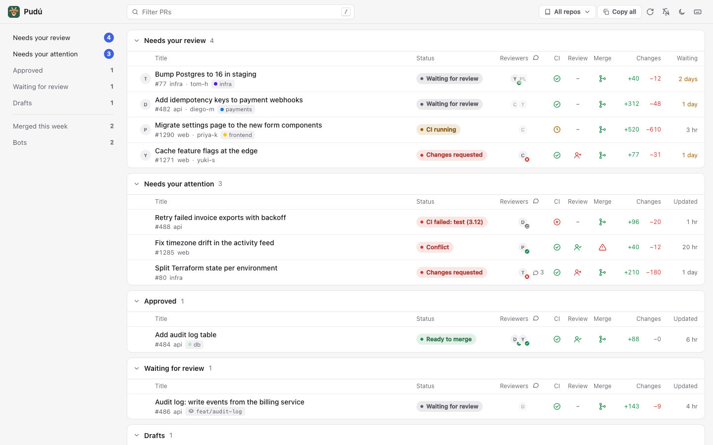

# Pudú

A local GitHub pull request inbox: what's waiting for your review and where your own PRs stand, on one page at `http://localhost:8765`.

<picture>
  <source media="(prefers-color-scheme: dark)" srcset="docs/screenshot-dark.png">
  
</picture>

Pudú is a Python standard-library server plus a single HTML page. It reads everything through the [`gh`](https://cli.github.com/) CLI with the session you already have, and serves the same inbox as LLM-friendly markdown and over MCP, so your coding agent can read it too. The layout takes its cue from Graphite's inbox.

> ¿Hablas español? La interfaz sigue el idioma de tu navegador, y el texto para agentes acepta `?lang=es`.

## Why Pudú

- **Local.** It listens on `127.0.0.1` only. Nothing leaves your machine except `gh`'s own calls to GitHub.
- **No tokens, no service.** No GitHub app, OAuth flow or personal access token to set up. If `gh pr list` works, Pudú works.
- **Nothing to build.** No dependencies, no `npm install`, no build step. One `server.py`, one `index.html`.
- **Agent-ready.** One line per PR with author, branches, CI, reviews, conflicts, threads, size and age, written to be pasted into Claude Code, Codex, Cursor or any other agent, plus a read-only MCP server.

## Features

- **Sections that answer "what's my move?":** needs your review, needs your attention (changes requested, failing CI, conflicts or open threads on your PRs), approved, waiting for review, drafts, merged this week and bots.
- **Re-reviews:** PRs you already reviewed that got new commits come back to your queue.
- **One status pill per row,** worst first, plus columns for CI, review decision, mergeability, reviewers, open threads, size and wait time.
- **Repo picker** to hide repos everywhere: page, tab badge, notifications and markdown.
- **Snooze** a PR until a time. It wakes early if anything happens on it.
- **Custom sections** from any GitHub search query.
- **Multiple accounts and hosts** (GitHub Enterprise included), using any account `gh` is logged in to.
- **Stacks, merge queue and auto-merge** in the agent text ("on top of #484", "in merge queue (#2)", "auto-merge on").
- **Keyboard-first,** with desktop notifications, light and dark themes, and English or Spanish UI.

## Quick start

You need **Python 3.9+** and **`gh`, logged in** (`gh auth login`).

```sh
git clone https://github.com/crow-rojas/pudu.git
cd pudu
./install.sh
```

The installer checks the requirements, runs the self-test and sets up Pudú to start at login and restart if it dies:

| | Service | Launcher |
|---|---|---|
| macOS | launchd agent `local.pudu` | `~/Applications/Pudú.app` (Spotlight or Dock) |
| Linux | systemd user service `pudu` | `Pudú` entry in your applications menu |

`PORT=8766 ./install.sh` serves on another port.

**No installer?** Run it in the foreground on any OS and open `http://localhost:8765`:

```sh
python3 server.py
```

**No `gh` yet?** Try it with fixture data: `python3 server.py --demo`.

## Daily use

| | macOS | Linux |
|---|---|---|
| Open | `Pudú.app`, or `open http://localhost:8765` | applications menu, or `xdg-open http://localhost:8765` |
| Logs | `tail -f ~/Library/Logs/pudu.log` | `journalctl --user -u pudu -f` |
| Restart | `./install.sh` (safe to re-run) | `./install.sh` or `systemctl --user restart pudu` |
| Uninstall | `./install.sh uninstall` | `./install.sh uninstall` |

- Edits to `index.html` show up on reload. Edits to `server.py` need a restart.
- `install.sh` pins the `python3` and `gh` it found in your shell, so re-run it after moving either.
- `Address already in use` when running by hand means the installed service already has the port: use `PORT=8766 python3 server.py`, or uninstall first.
- Uninstalling leaves your config file in place.
- **Linux, signed out from the service:** a systemd user service may not reach your desktop keyring. Run `gh auth login --insecure-storage`, then `./install.sh` again.

The page refreshes every minute and when you come back to the tab. The server caches GitHub's answer for 20 seconds, so several tabs share one set of `gh` calls.

## Keyboard shortcuts

Press `?` in the page for this list.

| Key | Action |
|---|---|
| `j` `k` / `↓` `↑` | Move between PRs |
| `[` `]` | Previous or next section |
| `o` / `Enter` | Open the PR on GitHub |
| `x` | Mark the PR as seen (clears the dot) |
| `y` | Copy the PR as agent text |
| `Y` | Copy everything visible as agent text |
| `c` | Copy the PR's branch name |
| `g` | Copy `gh pr checkout N -R owner/repo` |
| `/` | Filter by title, repo, author, number, branch or label |
| `p` | Choose which repos to show |
| `r` | Refresh now, skipping the cache |
| `t` | Toggle light and dark |
| `Esc` | Clear the filter, close, or deselect |
| `?` | Show the shortcuts |

## Configuration

Pudú keeps its preferences in one JSON file:

- `$PUDU_CONFIG` if set,
- else `$XDG_CONFIG_HOME/pudu/config.json`,
- else `~/.config/pudu/config.json`.

The page writes `hidden`, and the server writes `snoozed` and `account`. You can edit the file by hand; it's re-read on every request. Writes are atomic and keep keys Pudú doesn't know.

```json
{
  "hidden": ["acme/legacy-app"],
  "snoozed": {
    "acme/api#482": {"until": "2026-10-21T12:00:00Z", "updatedAt": "2026-10-20T09:14:02Z"}
  },
  "sections": [
    {"id": "team", "title": "Team queue", "query": "is:open team-review-requested:acme/backend"}
  ],
  "staleHours": 24,
  "account": {"host": "github.com", "user": "your-login"}
}
```

| Key | What it does |
|---|---|
| `hidden` | Repos (`owner/name`) left out of every section, the tab badge, notifications and the markdown. Set from the repo picker (`p`). Alt-click a repo to keep only that one. |
| `snoozed` | PRs hidden until `until` (UTC). A snoozed PR wakes early when its `updatedAt` on GitHub moves past the stored one, so a push, review or comment brings it back. Expired entries are pruned on the next write. |
| `sections` | Up to 10 extra sections, each a GitHub search. `id`: lowercase letters, digits, `-` or `_` (up to 40 characters), not a built-in id. `title`: up to 80 characters. `query`: up to 256 characters. Pudú adds `is:pr` and `archived:false` unless you set them; add `is:open` yourself if you want it. Each shows up to 50 PRs, and a broken query shows its error in its own section only. |
| `staleHours` | Hours after which a review request counts as stale, 1 to 720 (default 24). Returned as `settings.staleHours` in `/api/data`. |
| `account` | The `gh` account Pudú queries as. Without it, Pudú uses `gh`'s active account. With it, Pudú runs `gh` with `GH_HOST` and that account's token (from `gh auth token --hostname H --user U`, kept in memory only). The account must be logged in to `gh`; `gh auth status` lists them. |

Environment variables:

| Variable | Default | Effect |
|---|---|---|
| `PORT` | `8765` | Port to listen on (always `127.0.0.1`). |
| `PUDU_CONFIG` | see above | Path of the config file. |
| `XDG_CONFIG_HOME` | `~/.config` | Base directory for the default config path. |
| `PUDU_LANG` | `en` | Default language (`en` or `es`) of the markdown and the MCP tools. `?lang=` overrides it per request. |
| `PUDU_DEMO` | unset | `1` serves fixture data without `gh`, like `--demo`. |
| `PUDU_NAME` | `pudu` | `install.sh` only: service name, so a second copy can be installed side by side. |

The installed service gets only `PORT`. To pass anything else, edit the launchd plist (`~/Library/LaunchAgents/local.pudu.plist`) or the systemd unit (`~/.config/systemd/user/pudu.service`).

## Using it with agents

### Over HTTP

Every PR line carries what you'd otherwise screenshot: title, repo and number, URL, author, branches, stack parent, CI with the failing checks, review decision and reviews, pending reviewers, conflicts, open threads, size, labels and age.

```sh
curl -s localhost:8765/inbox.md                          # the whole inbox
curl -s 'localhost:8765/inbox.md?s=review,returned'      # only some sections
curl -s 'localhost:8765/inbox.md?lang=es&force=1'        # in Spanish, skipping the cache
curl -s 'localhost:8765/pr.md?pr=acme/api%23482'         # one PR in depth
curl -s 'localhost:8765/pr.md?pr=https://github.com/acme/api/pull/482'
```

| Endpoint | Returns |
|---|---|
| `GET /inbox.md` | The inbox as markdown. `?s=` takes comma-separated section ids: `review`, `returned`, `approved`, `waiting`, `draft`, `merged`, `bots` and your custom section ids. `?lang=en\|es`, `?force=1`. |
| `GET /pr.md?pr=<url or owner/repo%23N>` | One PR: its inbox line, failed checks with links, unresolved review threads (`path:line @author: first comment`) and ready-to-run `gh pr checkout`, `gh pr diff` and `gh pr checks` commands. Encode `#` as `%23`. |
| `GET /api/data` | Everything the page uses, as JSON. `?lang=`, `?force=1`. |
| `POST /api/hidden` | `{"hidden": ["owner/repo", …]}` replaces the hidden repos. |
| `POST /api/snooze` | `{"key": "owner/repo#N", "until": "2026-10-21T12:00:00Z"}` snoozes a PR; `"until": null` wakes it. |
| `POST /api/account` | `{"host": "github.com", "user": "login"}` switches to another account `gh` is logged in to. |

POSTs need `Content-Type: application/json` and return the same JSON as `/api/data`. `force=1` is ignored when the last fetch is under 5 seconds old. Hidden repos and snoozed PRs are left out of the markdown; the header lists the hidden repos so the agent knows.

In the page, the **Copy** button on each section, **Copy all**, `y` and `Y` copy the same text, in the page's language and with your filter applied. In Claude Code, `! curl -s localhost:8765/inbox.md` drops it straight into the conversation.

### Over MCP

`python3 server.py --mcp` speaks MCP over stdio with two read-only tools:

- `list_inbox` with optional `sections` (list of section ids) and `refresh` (query GitHub now): the inbox markdown.
- `get_pr` with `pr` (URL or `owner/repo#N`): the `/pr.md` text.

The MCP server is its own process: it calls `gh` directly and reads the same config file, so it doesn't need the web server running. Use the absolute path to your clone in every example below. Add `PUDU_LANG=es` to the server's environment for Spanish.

**Claude Code**

```sh
claude mcp add --scope user pudu -- python3 /abs/path/to/pudu/server.py --mcp
```

**Codex CLI**

```sh
codex mcp add pudu -- python3 /abs/path/to/pudu/server.py --mcp
```

or in `~/.codex/config.toml`:

```toml
[mcp_servers.pudu]
command = "python3"
args = ["/abs/path/to/pudu/server.py", "--mcp"]
```

**Cursor** (`~/.cursor/mcp.json`) and **Gemini CLI** (`~/.gemini/settings.json`)

```json
{
  "mcpServers": {
    "pudu": {
      "command": "python3",
      "args": ["/abs/path/to/pudu/server.py", "--mcp"]
    }
  }
}
```

> **Treat PR text as untrusted.** Titles, branch names, labels and review comments are written by other people, and a PR can carry text meant to steer an agent. `/pr.md` and `get_pr` mark review threads as untrusted third-party text, and the MCP server exposes no write tools, but review what your agent does with what it reads.

## Security

Pudú is a local server, so the threats are web pages in your browser and other processes on your machine:

- It binds to `127.0.0.1` only.
- It rejects any `Host` header other than `localhost:PORT`, `127.0.0.1:PORT` or `[::1]:PORT`, which blocks DNS rebinding.
- It rejects requests whose `Sec-Fetch-Site` is present and not `same-origin` or `none`, and writes require `Content-Type: application/json` and a body under 1 MB, which blocks cross-site requests from other pages.
- It stores no tokens. GitHub access goes through `gh` and its credential storage; a chosen account's token is fetched from `gh` and kept in memory only.
- The MCP server is read-only.

See [SECURITY.md](SECURITY.md) to report a vulnerability.

## Windows and WSL

- **WSL:** clone inside WSL and use the Linux path. `./install.sh` needs systemd enabled in WSL (`[boot] systemd=true` in `/etc/wsl.conf`) and skips the launcher: open `http://localhost:8765` in your Windows browser.
- **Native Windows:** there's no installer. With Python and `gh` installed and logged in, run `py server.py` and open `http://localhost:8765`. The config lives in `%USERPROFILE%\.config\pudu\config.json` unless you set `PUDU_CONFIG`.

## Contributing

Bug reports and small, focused PRs are welcome. Read [CONTRIBUTING.md](CONTRIBUTING.md) first: no dependencies, no build step, and screenshots only from `--demo` data. Release notes are in [CHANGELOG.md](CHANGELOG.md).

## License

[MIT](LICENSE)
